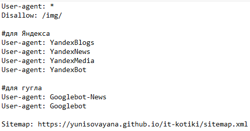
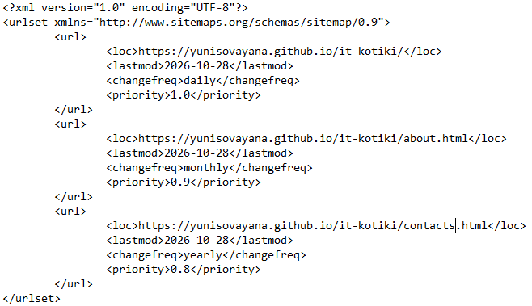

<h3>Поисковая оптимизация (SEO)</h3>  

SEO - комплекс действий, направленных на повышение видимости сайта в поисковых системах по релевантным запросам.  

**2.1. Создание проекта**  

1.	Создать папку lalala (важно именно это название).  


2.	Создать файлы:  

- index.html  
- about.html  
- contacts.html  

**2.2. Заполнение index.html**  

Заполнено по примеру из задания.  

**2.3. Оптимизация about.html и contacts.html**  

- Уникальные `<title>` и `<meta description>`  


index.html:  
```
<title>Курсы IT - Главная</title>
<meta name="description" content="Учебный сайт про курсы IT. SEO-анализ сайта на GitHub Pages.">
```

about.html:  
```
<title>Курсы IT - О нас</title>
<meta name="description" content="О нашем учебном сайте про курсы IT. SEO-анализ сайта на GitHub Pages.">

```

contacts.html:  
```
<title>Курсы IT - Контакты</title>
<meta name="description" content="Контакты учебного сайта про курсы IT. SEO-анализ сайта на GitHub Pages.">
```


- Структура заголовков `<h1>–<h3>`


- Добавить изображения с корректным alt

Пример одного добавленного изображения в index.html:  
```

```


**2.4. Создание robots.txt и sitemap.xml**  

- Создать robots.txt в корне

  
  
- Создать sitemap.xml со всеми URL

  

  
- Связать файлы:  
Sitemap: `https://yunisovayana.github.io/it-kotiki/sitemap.xml`  


**2.5. Публикация на GitHub Pages**  

1.	Создать репозиторий.

  
2.	Загрузить все HTML-файлы + sitemap + robots.

   
3.	Включить Pages: Settings → Pages.


**2.6. Проверка и анализ**  

1.	Проверить сайт в Google Search Console и Яндекс.Вебмастере.

   
2.	Проанализировать сниппеты.

   
3.	Проверить индексацию.  


**Контрольные вопросы**  

1.	Что такое SEO и каковы его цели?  

SEO - комплекс действий, направленных на повышение видимости сайта в поисковых системах по релевантным запросам.  
   
2.	Как происходит цикл: краулинг → индексация → ранжирование?  

Краулинг - поисковый робот сканирует сайт.  
Индексация - информация о страницах сохраняется в поисковом индексе.  
Ранжирование - определение порядка показа страниц по конкретным запросам.  

   
3.	Какие теги влияют на сниппет?  

Заголовок страницы (`<title>`), описание сниппета (`<meta name="description">`).  
   
4.	Почему важны alt-тексты и единичный H1?  

Alt-тексты важны потому, что описывают картинку для незрячих людей и помогают поисковикам понять, что на изображении (так картинка может попасть в поиск по картинкам). Один H1 важен потому, что это главный заголовок страницы, поисковику проще понять, о чём страница, когда главная тема одна, читателю легче ориентироваться, а если H1 несколько поисковик путается, какая тема главная.
   
5.	Какие метрики скорости важны для SEO?  

LCP (как быстро появляется главный большой элемент, должно быть меньше 2,5 секунды), INP (как быстро страница реагирует на клики, меньше 200 миллисекунд), CLS (не прыгает ли вёрстка при загрузке, меньше 0,1) и TTFB (как быстро сервер отдаёт первый байт, меньше 0,8 секунды).
    
6.	Как помогают валидаторы (W3C, PageSpeed)?  
W3C Validator проверяет HTML и CSS на ошибки (кривые теги, забытые закрывающие скобки, отступления от стандарта, чтобы сайт одинаково работал в разных браузерах и код был понятен поисковикам). PageSpeed Insights показывает скорость сайта, что именно тормозит и разницу между мобильными и десктопом.
    
7.	Как подтвердить сайт в Яндекс.Вебмастере?  

Создать отдельный файл в корне проекта с названием и содержимым, которым просит Вебмастер, далее в течение 24 часов получится подтведрить сайт (спойлер: всё равно не подтвердится).  
    
