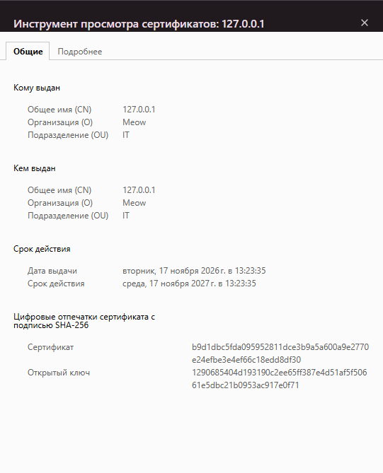

# Практическая работа № 1

**Тема:** Настройка защищённого HTTPS-соединения (SSL/TLS) на Ubuntu Server с Apache2.

**Цель:** Научиться устанавливать Apache2, создавать самоподписанный TLS-сертификат, настраивать HTTPS и проверять защищённое соединение.

## 1. Теоретическая часть

SSL (Secure Sockets Layer) — устаревший протокол защиты данных. В современных системах используется TLS (Transport Layer Security). HTTPS — HTTP поверх TLS, обычно на порту **443** (HTTP использует порт **80**). TLS обеспечивает шифрование, целостность и проверку подлинности сервера при использовании доверенного сертификата.

## 2. Необходимое ПО

- Ubuntu Server 22.04 или 24.04;
- права `sudo`;
- Apache2 и OpenSSL;
- браузер и доступ к серверу по сети.

В учебной работе используется **самоподписанный сертификат**. Доменное имя не требуется. Во всех примерах замените `192.168.1.100` на IP-адрес своего сервера.

## 3. Ход работы

### Шаг 1. Обновление системы

```bash
sudo apt update
sudo apt upgrade -y
```

### Шаг 2. Установка Apache2

```bash
sudo apt install apache2 -y
sudo systemctl enable --now apache2
sudo systemctl status apache2
```

Ожидаемый статус: `active (running)`.

### Шаг 3. Проверка HTTP

```bash
hostname -I
```

Откройте `http://192.168.1.100` в браузере. Должна появиться стандартная страница Apache2.

### Шаг 4. Включение SSL-модуля

```bash
sudo a2enmod ssl
sudo systemctl restart apache2
sudo apache2ctl -M | grep ssl
```

Ожидаемый вывод: `ssl_module (shared)`.

### Шаг 5. Создание TLS-сертификата

```bash
sudo apt install openssl -y
sudo mkdir -p /etc/apache2/ssl
sudo openssl req -x509 -nodes -days 365 \
  -newkey rsa:2048 \
  -keyout /etc/apache2/ssl/server.key \
  -out /etc/apache2/ssl/server.crt \
  -subj "/CN=192.168.1.100" \
  -addext "subjectAltName=IP:192.168.1.100"
sudo chmod 600 /etc/apache2/ssl/server.key
```

- `server.crt` — сертификат сервера;
- `server.key` — закрытый ключ (не публиковать и не передавать посторонним).

Параметр SAN указывает IP-адрес, для которого выпущен сертификат. Самоподписанный сертификат всё равно не будет автоматически доверенным в браузере.

### Шаг 6. Настройка HTTPS в Apache2

Создайте конфигурацию:

```bash
sudo nano /etc/apache2/sites-available/ssl-site.conf
```

Содержимое файла:

```apache
<VirtualHost *:443>
    ServerName 192.168.1.100
    DocumentRoot /var/www/html

    SSLEngine on
    SSLCertificateFile /etc/apache2/ssl/server.crt
    SSLCertificateKeyFile /etc/apache2/ssl/server.key
    SSLProtocol -all +TLSv1.2 +TLSv1.3

    ErrorLog ${APACHE_LOG_DIR}/ssl-error.log
    CustomLog ${APACHE_LOG_DIR}/ssl-access.log combined
</VirtualHost>
```

Сохраните файл: `Ctrl+O`, `Enter`, `Ctrl+X`.

### Шаг 7. Активация сайта

```bash
sudo a2ensite ssl-site.conf
sudo apache2ctl configtest
sudo systemctl reload apache2
```

Ожидаемый результат проверки: `Syntax OK`.

### Шаг 8. Разрешение портов

Если UFW используется:

```bash
sudo ufw allow 'Apache Full'
sudo ufw status
```

Это правило разрешает TCP-порты 80 и 443. Если UFW отключён, включать его специально для работы не требуется. Если сервер находится в облаке, проверьте также внешние правила сетевого экрана.

### Шаг 9. Проверка HTTPS

Откройте в браузере:

```text
https://192.168.1.100
```

Браузер может предупредить, что сертификат не доверен: для самоподписанного сертификата это ожидаемо. В учебной среде можно вручную разрешить переход.  



### Шаг 10. Перенаправление HTTP на HTTPS

Откройте:

```bash
sudo nano /etc/apache2/sites-available/000-default.conf
```

Внутри существующего блока `<VirtualHost *:80>` добавьте:

```apache
Redirect permanent / https://192.168.1.100/
```

Проверьте конфигурацию и примените изменения:

```bash
sudo apache2ctl configtest
sudo systemctl reload apache2
```

Теперь запрос к `http://192.168.1.100` должен перенаправляться на `https://192.168.1.100`.

### Шаг 11. Проверка из терминала

```bash
curl -k -I https://192.168.1.100
curl -I http://192.168.1.100
openssl x509 -in /etc/apache2/ssl/server.crt -text -noout
```

Первый запрос должен возвращать успешный HTTP-ответ (обычно `200 OK`), второй — перенаправление `301 Moved Permanently` с заголовком `Location: https://...`. Ключ `-k` отключает проверку доверия к сертификату **только для учебного тестирования**.

## 4. Результаты работы

| Проверка | Ожидаемый результат |
|---|---|
| Служба Apache2 | `active (running)` |
| SSL-модуль | `ssl_module (shared)` |
| Сертификат и ключ | Файлы созданы |
| Проверка конфигурации | `Syntax OK` |
| HTTPS на порту 443 | Сайт открывается |
| HTTP → HTTPS | Перенаправление 301 |

## 5. Контрольные вопросы

1. Чем TLS отличается от SSL?
2. В чём разница между HTTP и HTTPS?
3. Какой порт обычно используется для HTTPS?
4. Для чего нужен TLS-сертификат?
5. Почему браузер не доверяет самоподписанному сертификату?
6. Как включить SSL-модуль Apache2?
7. Для чего нужен файл `server.key`?
8. Как проверить конфигурацию Apache2?
9. Для чего используется поле SAN в сертификате?
10. Как настроить перенаправление с HTTP на HTTPS?

## 6. Вывод

В ходе практической работы установлен и настроен веб-сервер Apache2 на Ubuntu Server, включён SSL-модуль, создан самоподписанный TLS-сертификат, настроен виртуальный хост на порту 443 и выполнена проверка HTTPS. Также настроено перенаправление с HTTP на HTTPS.

**Примечание:** для публичных сайтов рекомендуется использовать сертификат доверенного центра сертификации, например Let's Encrypt, а не самоподписанный сертификат.
