<h3>Сниппеты, SEO-теги и семантическая разметка</h3>   

**2.1. Создание сайта из 3 страниц**   

Создание сайта из 3 страниц:  
Необходимо разработать сайт, состоящий из:  
- index.html  
- about.html  
- contacts.html  
Требования:  

- Каждая страница содержит корректную структуру (`header/nav/main/footer`);  

- На главной странице SEO оформлены идеально;

  
- На двух страницах - преднамеренные типичные ошибки:
два h1; пустой alt; отсутствующий description; слишком длинный <title>.  

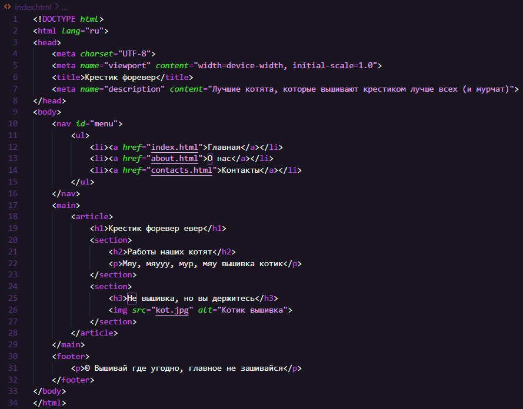  
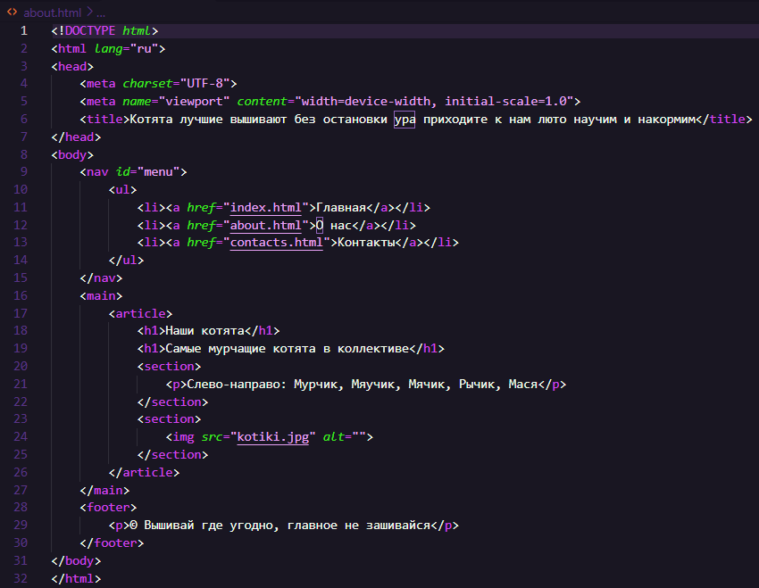  
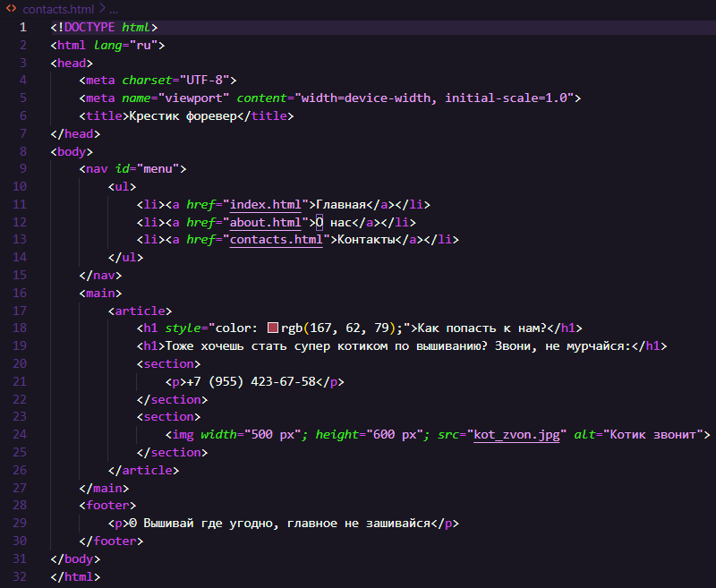  

**2.2. Публикация на GitHub Pages**   
Создать GitHub-репозиторий  
Загрузить HTML-файлы  
Включить GitHub Pages  

https://yunisovayana.github.io/vyshivka/  

**2.3. Проверки SEO и качества кода**  
Провести анализ каждой страницы:  

*W3C Validator - валидность HTML*  
Главная:  
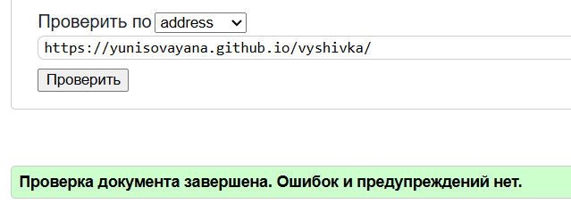  

О нас:  
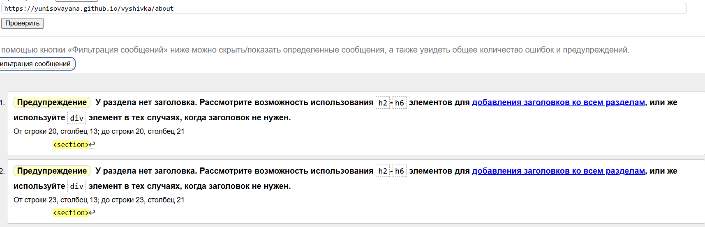  

Контакты:  
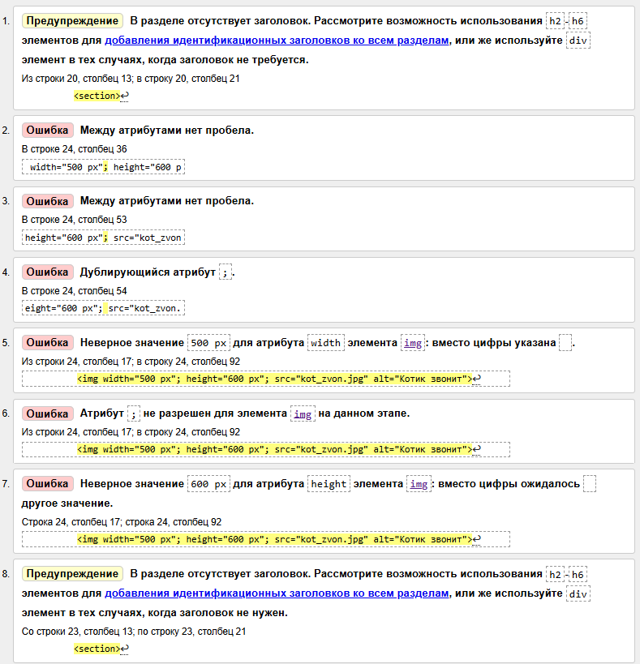  

*PageSpeed Insights - показатели Core Web Vitals*  
Главная:  
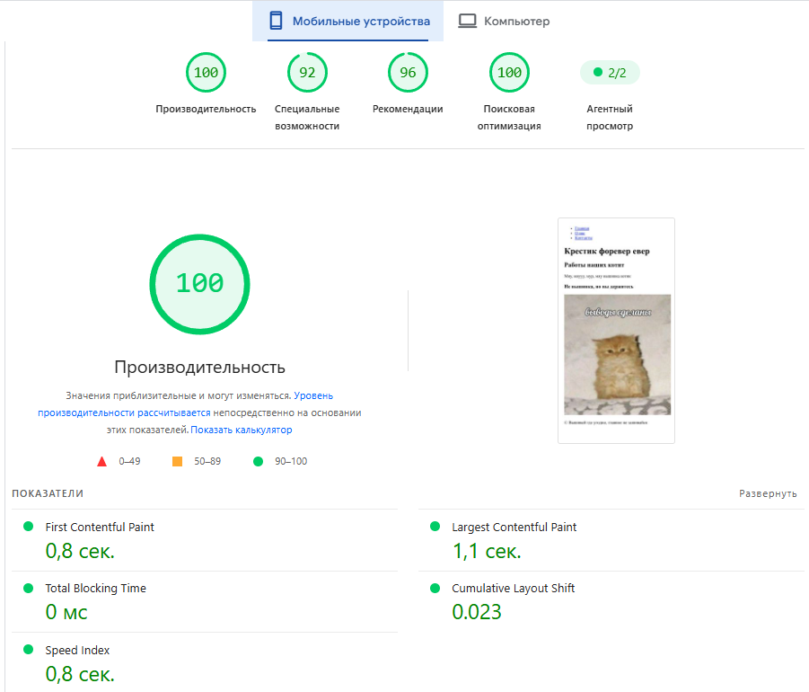  
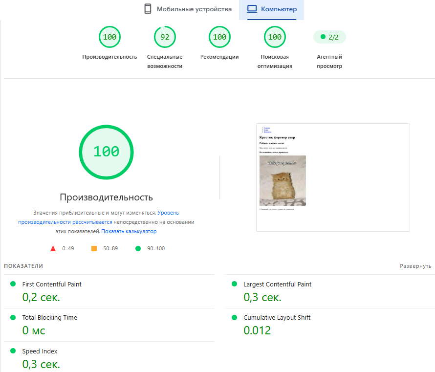  

О нас:  
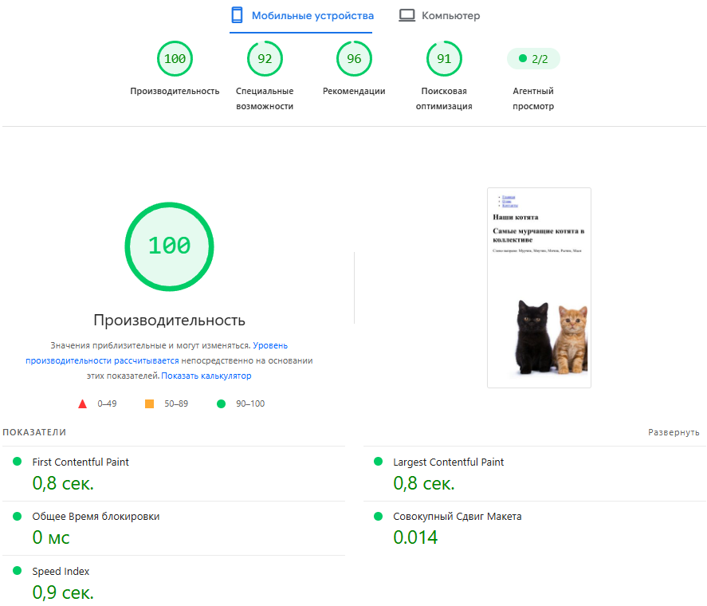  
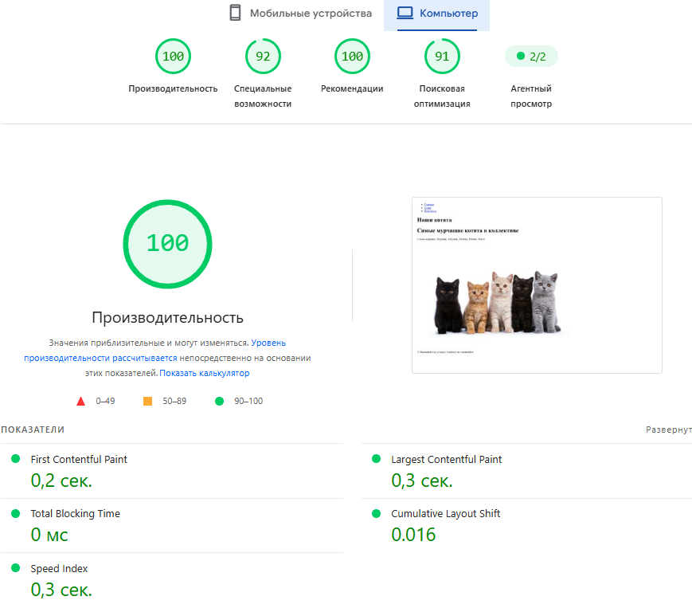  

Контакты:  
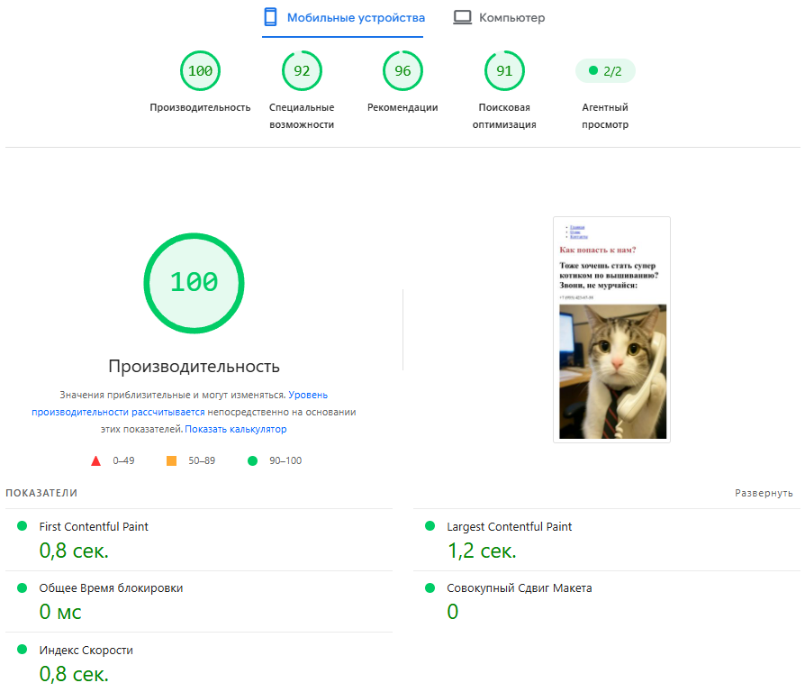  
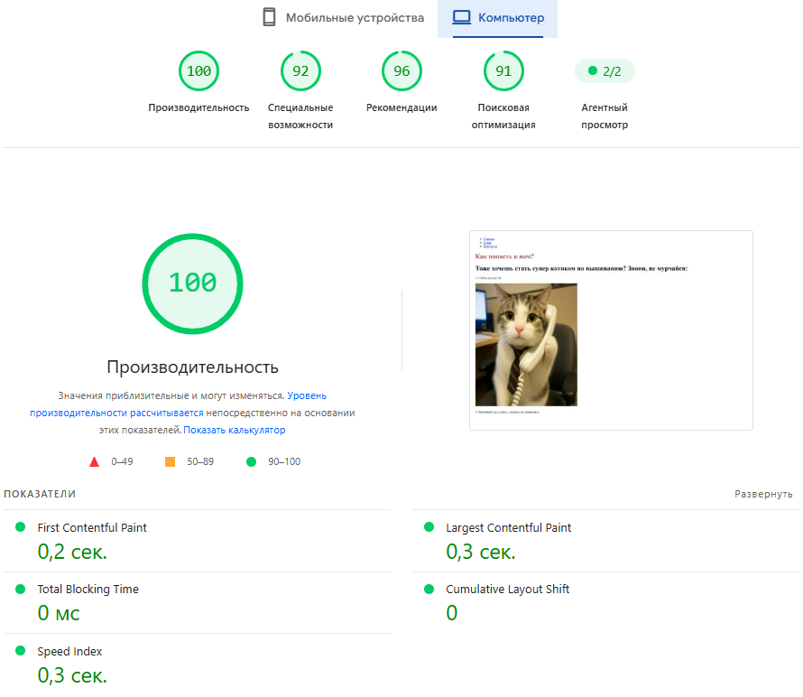  

**2.4. Описание и анализ ошибок**   
Для двух страниц с ошибками составить:  

### Таблица ошибок
| Ошибка | Описание причины | Влияние на SEO | Что нужно исправить (и почему) |
|--------|------------------|----------------|--------------------------------|
| Отсутствие заголовка | Отсутствует заголовок (что описывать-то) | Поисковые системы используют заголовки для понимания содержания страницы. Google и Яндекс анализируют теги `<h>` для определения релевантности контента поисковым запросам | Добавить заголовок, чтобы позволять поисковикам быстро определить, о чем страница |
| Ошибка к img | Неверный синтаксис (атрибуты, пробелы и т.д.) | Например, отсутствие alt снижает релевантность картинки в поисковом запросе, т.к. поисковые системы не могут «видеть» изображения(alt помогает им понять содержание картинки и продвинуть по запросуц) | Добавить alt, чтобы увеличить релевантность страницы по запросам к этому изображению и исправить другой синтаксис |

**Контрольные вопросы:**  

1. Что формирует сниппет и как на него влияет HTML-код?  

Основу сниппета формируют теги `<title>` и `<meta name="description">`, а также содержимое самой страницы - поисковик может брать фрагменты текста, если `description` отсутствует или не соответствует запросу. HTML-код влияет на сниппет через корректность и уникальность `title` и `description`, через структуру заголовков `<h1>–<h6>`, через атрибуты `alt` изображений и через семантическую вёрстку `<header>`, `<nav>`, `<main>`, `<article>`, которая помогает поисковику понять, какие блоки страницы являются основными.  

2. Какие SEO-теги обязательны на каждой странице?  

Уникальный `<title>`, `<meta name="description">` (описание содержания), `<meta charset="UTF-8">` для корректной кодировки, `<meta name="viewport">` для адаптивности, `<html lang="...">` для указания языка, один `<h1>` как главный заголовок страницы и логичная иерархия `<h2>–<h6>`, `alt` у изображений формально не тег, но обязательный атрибут для SEO и доступности.  
 
3. Почему нельзя использовать несколько `<h1>`?  

Один главный заголовок всё равно удобнее и для пользователей, и для поисковиков.  
 
4. Зачем нужен alt и как он влияет на SEO?  

alt показывается, если изображение не загрузилось, и его читают скринридеры для незрячих пользователей. Для SEO alt помогает Google и Яндексу понять, что изображено на картинке, особенно в поиске по картинкам.  
 
5. Почему важно уникализировать `<title>` и `<description>`?  

Потому что одинаковые заголовки и описания на разных страницах поисковики воспринимают как признак некачественного или дублирующегося сайта. Если у нескольких страниц один и тот же title, робот не понимает, чем они отличаются, и может хуже их распределять по определённому порядку.  
 
6. Чем OpenGraph отличается от поисковых тегов?  

Поисковые теги (title, description) нужны для того, чтобы страница хорошо выглядела в результатах Google или Яндекса. OpenGraph (og:title, og:image и т.д.) нужен для того, чтобы ссылка красиво разворачивалась в соцсетях, мессенджерах (с картинкой, заголовком и описанием).  
 
7. Какие ошибки чаще всего приводят к плохой индексации?  

Дубли (одинаковый контент на разных URL, одинаковые title и description), закрытие важных разделов от индексации по ошибке, кривые редиректы.  
 
8. Как скорость загрузки влияет на ранжирование?  

Если страница грузится медленно, люди уходят до того, как что-то увидят, а поисковик понимает, что страница неудобна, и может снизить позиции.  
 
